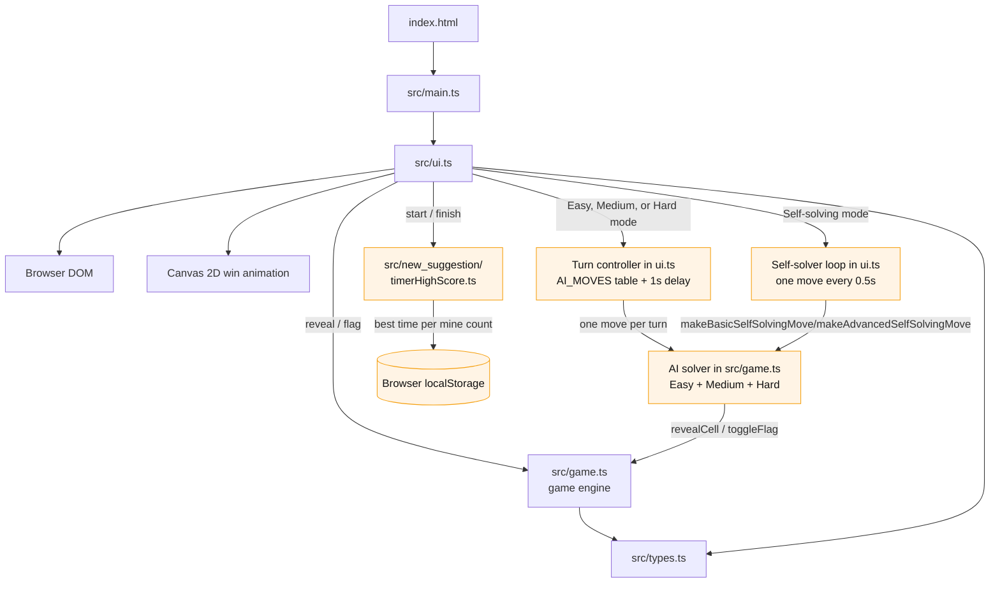

# Minesweeper System Design Summary

## Purpose

This project is a browser-based Minesweeper game implemented in TypeScript. The player selects a mine count, reveals safe cells, flags suspected mines, and starts a new game after a win or loss. 

The new enhanced system supports Normal mode with a timer, Easy AI, Medium AI, Hard AI, Basic Self-Solving mode, and Advanced Self-Solving mode. Project 2 extends the original system with multiple new AI features and a high-score tracking timer for Normal mode. 

## Architecture



Orange boxes were added in Project 2.

- `index.html` provides the application root and loads the compiled entry point.
- `src/main.ts` starts the application by rendering the start screen, then passes the chosen mine count and game mode to the game screen.
- `src/ui.ts` owns screen rendering, browser events, board-cell interaction, HUD updates, and the win animation. The start screen has a game mode dropdown (Normal, Easy AI, Medium AI, Hard AI, Basic Self-Solving, Advanced Self-Solving).
- **Turn controller** (inside `src/ui.ts`): in an AI mode, it waits one second after each player move, then calls the AI move function for the selected mode from the `AI_MOVES` table. The board is locked while the AI move is pending, and starting a new game cancels it. Adding a new difficulty only needs one new entry in `AI_MOVES` and one dropdown option.
- **Self-solver loop** (inside `src/ui.ts`): in Basic Self-Solving mode, the computer plays the whole game alone. It calls `makeBasicSelfSolvingMove` every half second until the game is won or lost, and player clicks are ignored.  In Advanced Self-Solving mode, it calls `makeAdvancedSelfSolvingMove`, which reuses the Hard AI's deduction logic and ignores player clicks. Both modes continue automatically until the game is won or lost. A pending move is cancelled when a new game starts.
- **AI solver** (inside `src/game.ts`): `makeEasyAIMove`, `makeMediumAIMove`, and `makeHardAIMove` each make exactly one move per call. Easy reveals a random covered cell, never picking a flagged or already revealed one. Medium applies the two basic rules (flag all hidden neighbors when they must all be mines, open the rest when a number's flags are satisfied) and otherwise clicks a random covered cell. Hard adds the 1-2-1 pattern rule before falling back to a random click. `makeBasicSelfSolvingMove` reuses the Easy logic and `makeAdvancedSelfSolvingMove` reuses the Hard AI logic. The AI only reads what a player can see (cell state and numbers), never `isMine`, and acts through the same `revealCell` and `toggleFlag` functions the player uses.
- `src/game.ts` owns board creation, mine placement, adjacent-mine counts, revealing, flagging, win detection, and loss handling.
- `src/new_suggestion/timerHighScore.ts` is the custom addition. It starts the clock on the first reveal, freezes it on a win or loss, and saves the fastest winning time for each mine count in the browser's `localStorage`. The HUD shows the current time and the best time. Its UML diagram is in `src/new_suggestion/documents_uml/minesweeper_addition_uml.pdf`.
- `src/types.ts` defines shared constants, data structures, coordinate helpers, and bounds checking.
- `style.css` supplies the visual design and responsive board layout.
- Tests: `src/game.test.ts` covers the game rules and the AI levels, and `src/new_suggestion/timerHighScore.test.ts` covers the timer and high scores.

## System Architecture Overview
The Minesweeper project uses a modular design where different files work together to run the game. Each file has its own responsibility, making the program easier to understand, maintain, and update. 

The first application starts with `main.ts`, which initializes the game and connects the start screen to the user interface. The `ui.ts` file handles everything the player sees and interacts with, including the game board, buttons, and the messages.

The player will then select a square where the `ui.ts` communicates with `game.ts`, which handles the actual game rules. These include placing mines, revealing squares, flagging mines, and determining whether the game has been won or lost.

In Project 2, the game is expanding with Easy, Medium, and Hard AI features, along with Basic and Advanced Self-Solving modes. The AI uses the same board game logic as the player, allowing the computer to make moves without changing how the original game works. The project also includes a custom timer and high-score feature for Normal mode. The `timerHighScore.ts` module manages elapsed time and saved winning records, using browser `localStorage` to keep high scores.

The `types.ts` file defines the shared data structures used throughout the system, while `style.css` controls the appearance of the game.

This design keeps the game organized by separating the user interface, gameplay logic, and shared data. 

## Architectural Components
### Application Startup - `main.ts`
The main.ts file is responsible for starting the Minesweeper application.

It displays the starting screen and connects the player’s game settings to the user interface. When the player starts a new game, it passes the selected settings to `ui.ts`.
This file keeps the startup process separate from the actual game logic.

### User Interface - `ui.ts`
The `ui.ts` file manages everything the player sees and interacts with during the game. It displays the Minesweeper board, handles mouse clicks, updates the mine counter, and shows messages when the game is won or lost. 

In Project 2, this file also helps control the different AI modes. It determines when the AI should make a move and updates the screen afterward.
This allows the interface to handle player interactions while `game.ts` manages the rules. 

### Game Logic - `game.ts`
The `game.ts` file contains the main rules and functions that control how Minesweeper works. Its responsibilities include creating the board, placing mines, revealing squares, flagging cells, and checking whether the player has won or lost.

In Project 2, additional functions are being implemented for the AI difficulties. 
- **Easy AI**: Randomly selects a covered square while avoiding revealed cells.
- **Medium AI**: Uses basic Minesweeper rules to identify safe squares and possible mines.
- **Hard AI**: Uses more advanced logic, including the 1-2-1 pattern, to make decisions.
- **Basic Self-Solving:** Reuses the Easy AI's random-move logic.
- **Advanced Self-Solving:** Reuses the Hard AI's deduction logic.

These AI features reuse the original game functions, allowing the computer and player to follow the same game rules. 

### Data Structures - `types.ts` 
The types.ts file defines the important data structures used throughout the game. These include the board size, number of mines, cell information, coordinates, and game status. For example, each cell stores whether it contains a mine, how many mines are nearby, and whether it is covered, revealed, or flagged. By keeping this information in one file, the other modules can use the same data structures consistently. 

### Timer and High Scores - `timerHighScore.ts`
The `timerHighScore.ts` file is part of the custom feature added in Project 2. It tracks how much time the player spends completing a game and saves the fastest winning time. This feature communicates with `ui.ts` to display the timer and high scores. The best times are saved using the browser’s local storage. Keeping this functionality separate makes it easier to update without changing the original game rules. 

### Testing - `game.test.ts` 
The `game.test.ts` file contains automated tests used to verify that the game works correctly. The original tests check features such as mine placement, flagging, revealing squares, and winning or losing.

In Project 2, additional tests check AI behavior, such as ensuring Easy AI does not select already revealed cells. These tests help identify problems and make sure that new features do not break existing functionality.

### Supporting Files
- `index.html`: Provides the main HTML structure and loads the game into the browser.   
- `style.css`: Controls the appearance of the game, including colors, buttons, board layout, and visual effects. 

## Data Model

A `Board` contains:

```text
Board {
  cells: Cell[][]
  rows: number
  cols: number
  mineCount: number
  gameStatus: 'ready' | 'playing' | 'won' | 'lost'
}
```

Each `Cell` contains:

```text
Cell {
  isMine: boolean
  adjacentMines: number
  state: 'covered' | 'flagged' | 'revealed'
}
```

Coordinates are zero-indexed internally. The UI renders a 10-by-10 board, with columns A-J and rows 1-10 for player-facing labels.

### Key Data Structures - Additions

**1. Game Modes and AI Move Mapping**   
The `GameMode` type in `src/ui.ts` identifies the selected game mode: Normal, Easy AI, Medium AI, Hard AI, Basic Self-Solving, or Advanced Self-Solving.
The `AI_MOVES` record maps each interactive AI mode to the correct move function. This allows the UI to use the right AI strategy and promotes reusability by preventing a separate turn control for each type.

**2. AI Medium and Hard Sets**   
The AI logic in `src/game.ts` uses two sets of strings to track cells for medium and hard AI interactive modes:
- **Mine set (`Set<string>`):** Stores coordinates of cells the AI has determined are mines.
- **Safe-cell set (`Set<string>`):** Stores the coordinates of cells that AI determined are safe.

**3. Candidate Cell Lists**     
The AI uses arrays of row-and-column coordinate pairs (`Array<[number, number]>`) to store covered cells. This allows modes, such as Easy-AI, to keep track of which cells may be selected.

**4. AI Turn and Self-Solver Control**    
The UI uses the `aiControl` object with a pending timer and a Boolean to show whether an AI move is waiting to execute. This disallows a player to move while an interactive AI turn is pending. 

**5. Timer and High-Score Data**    
The custom timer feature is managed by `TimerHighScoreController` in `src/new_suggestion/timerHighScore.ts`. The UI uses a `TimerSnapshot` that uses the elapsed time, the best recorded time (or `null` if no record exists), and a Boolean to show whether the current result is a new best score. This feature operates in Normal mode and stores the winning time in `localStorage` to allow records to remain in the browser for each mine count.

## Interface Description - with additions
### User Input   
The user interacts through the browser-based interface, which is implemented in `src/ui.ts`.
- Game Setup: The player will select a mine count from 10 to 20 using the slider and then choose one of the six available game modes using the dropdown selector.
- Cell Revealing: In Normal mode, the player can left-click to reveal a covered cell. In the interactive AI modes, the player and AI alternate turns. This means when it is the AI's turn, the user may not reveal a cell. Also, in the self-solving modes, the user cannot change or click the board.
- Flagging: In Normal mode, the player may right-click to flag a covered cell or remove a flag. Flagging is disabled in the other modes.
- Self-Solving Modes: In Basic and Advanced Self-Solving modes, the computer performs moves automatically.
- New Game: The New Game button cancels pending AI or self-solver moves, disposes of the timer in Normal mode, and returns the player to the start screen.
### User Interface
The user interface displays the board state and provides feedback to the user. The following is related to the new modes developed:
- **Game Mode Selector:** Adds a dropdown to the start screen with six options.
- **Interactive AI Modes:** Displays the selected AI difficulty and allows alternating player and AI turns.
- **Timer and High Scores:** In Normal mode, shows the elapsed game time and the best recorded winning time for the selected mine count.
- **AI Result Messages:** Displays the winner or loss message when an interactive AI game ends or a self-solving attempt fails.

These additions extend the original interface while allowing the original controls and game board to stay.

### Component Interfaces
The system components communicate through imported functions and shared callbacks.
- **Game Mode Selection** (`main.ts` and `ui.ts`): `main.ts` calls `renderStartScreen()` to display the initial screen. The callback passes the selected mine count and game mode to `renderGameScreen()` to initialize the appropriate mode.
- **Interactive AI Interface** (`ui.ts` and `game.ts`): The `AI_MOVES` record maps Easy, Medium, and Hard AI modes to `makeEasyAIMove()`, `makeMediumAIMove`, and `makeHardAIMove`. Each function will also receive the current `Board` and return a Boolean to show if a move was made. The UI schedules the AI to have an uninterrupted turn and refresh the board after an action from AI.
- **Self-Solving Interface** (`ui.ts` and `game.ts`): Basic Self-Solving calls `makeBasicSelfSolvingMove()` which will reuse the easy AI logic to operate. Advanced Self-Solving calls `makeAdvancedSelfSolvingMove()` which also will reuse Hard AI logic. The UI will schedule the moves to continue to occur until the game ends.
- **Timer and High-Score Interface** (`ui.ts` and `timerHighScore.ts`): For normal mode the UI will create `TimerHighScoreController` and uses its corresponding methods to handle the timing and its information. The `TimerSnapshot` will show the elapsed time, the best time, and an answer to if the new best time was earned.

## Game Flow - with additions

1. `renderStartScreen` displays the mine-count slider from 10 through 20. Also a game-mode dropdown with Normal, Easy AI, Medium AI, Hard AI, Basic Self-Solving, and Advanced Self-Solving options.
2. Starting a game calls `createGame`, which creates an empty 10-by-10 board in `ready` status.
3. The first `revealCell` call places mines randomly while excluding the clicked cell and its surrounding eight-cell safe area.
4. Mine placement increments `adjacentMines` on neighboring cells and changes the board to `playing`.
5. Revealing a safe zero-count cell performs an iterative flood reveal of neighboring safe cells.
6. Revealing a mine reveals every mine and changes the board to `lost`.
7. Revealing every non-mine cell changes the board to `won` and flags remaining mines.
8. In Normal mode, right-clicking a covered cell toggles its flag. The number of flags cannot exceed `mineCount`. Flagging is disabled in AI and self-solving modes.   
9. After every action, the UI rerenders the board and displays `mineCount - flaggedCount` as the remaining-mine counter.
10. The New Game button returns the player to the configuration screen. It will cancel pending AI or self-solving moves and remove the timer when applicable.
11. In interactive modes, the UI schedules one AI move one second after a valid player move. Player input is disabled while the AI move is pending.
12. The `AI_MOVES` record selects the function for the chosen AI difficulty. Easy AI randomly reveals a covered cell. Medium AI applies two basic deduction rules before falling back to a random choice. Hard AI adds the 1-2-1 pattern rule. The AI uses the existing game logic to reveal its selected cell.
13. In Basic Self-Solving mode, the UI automatically makes a move every 0.5 seconds using `makeBasicSelfSolvingMove`. User cell clicks are ignored.
14. In Advanced Self-Solving mode, the UI automatically makes a move every 0.5 seconds using `makeAdvancedSelfSolvingMove`. The solver continues until the game ends. User cell clicks are ignored.
15. In Normal mode, the timer starts when the first reveal changes the game status from `ready` to `playing`. It stops when the game is won or lost. Only winning games will update the best time for the selected mine count, with records saved in browser `localStorage`.
16. When an interactive AI game or a self-solving game ends, the UI displays the appropriate result message and stops further game moves. In Normal mode, the timer and high-score display show the final timing result.

## State Rules

- `ready`: mines have not been generated; the first reveal initializes the board.
- `playing`: player can reveal and flag cells, an AI opponent can make moves, or the self-solver can play automatically.
- `won`: all safe cells are revealed; further actions are ignored.
- `lost`: a mine was revealed; further actions are ignored.
- A revealed cell cannot be flagged.
- A flagged cell cannot be revealed.
- Flagging is capped at the selected mine count, but flags may always be removed. Flagging is disabled in AI and self-solving modes.

## Extension Points

- Board dimensions and mine limits are centralized in `src/types.ts`.
- Game rules are isolated from the DOM in `src/game.ts`, allowing unit tests or another UI to reuse them.
- Rendering is isolated in `src/ui.ts`, allowing future keyboard controls, touch controls, or alternate layouts.
- The current `Board` model can be extended with more gameplay statistics, player metadata, difficulty names, or persisted game state without changing the cell interaction API.
- `src/game.test.ts` provides a starting point for expanding automated rule coverage.

The modular structure allows future teams to improve Minesweeper without having to rebuild the entire project. For example, the next developers can add new AI difficulties, improve the user interface, or create additional game features while continuing to use the existing game logic. Keeping everything organized and clean for future developers to read and not to make further mistakes can help as well. Overall, this architecture makes Minesweeper easier to maintain, test, and expand in the future. 

## Verification

Run the complete build and gameplay tests with:

```bash
npm test
```

The test command compiles TypeScript and runs the Node test suite in `dist/game.test.js`.
